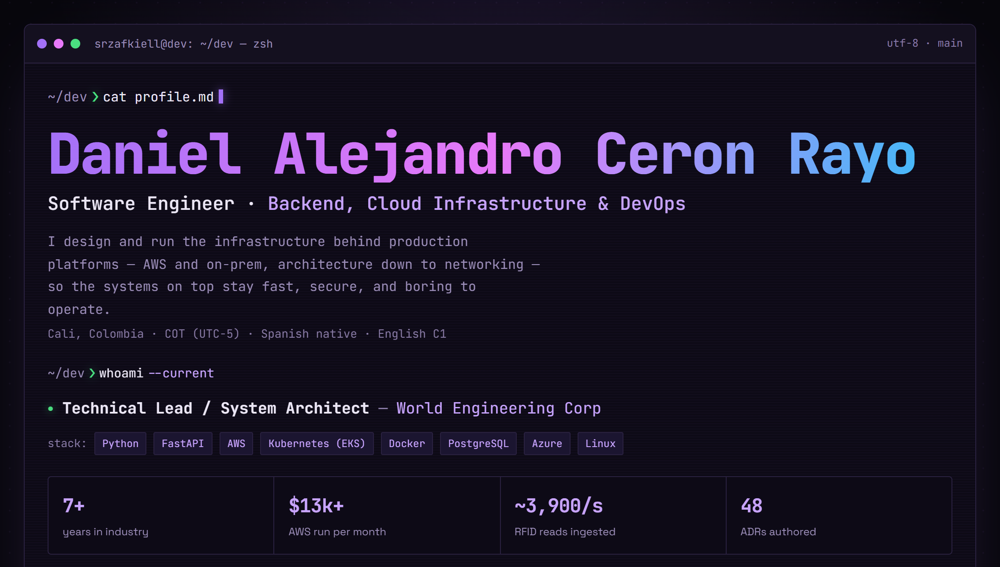

A preview of my portfolio, <a href="https://srzafkiell.dev">srzafkiell.dev</a>. Click the image to open it.

# Hi, I'm Alejandro

**Software Engineer | Backend, Cloud Infrastructure & DevOps.** Based in Cali, Colombia (UTC-5), working remotely.

**I speak Spanish (native) and English (C1).** This profile is in English; for the Spanish version, see my [LinkedIn](https://www.linkedin.com/in/srzafkiell/?locale=es-ES).

I design and run the infrastructure behind production platforms, from architecture and API contracts down to networking: AWS, Amazon EKS, Azure, and on-prem Windows and Linux. 7+ years across backend, cloud architecture and DevOps, working end to end in Python, FastAPI, Django, PostgreSQL, SQL Server, Redis and Docker, from API design through CI/CD, monitoring and disaster recovery. I have led cross-functional engineering teams since my freelance years, and build in Java (Spring Boot) as well as Python.

**Portfolio:** [srzafkiell.dev](https://srzafkiell.dev) | **LinkedIn:** [in/srzafkiell](https://www.linkedin.com/in/srzafkiell/) | **Email:** [contact@srzafkiell.dev](mailto:contact@srzafkiell.dev)

Open to remote full-time and contract roles.

### Right now

- **Technical Lead / System Architect at World Engineering Corp** (since Jun 2026, promoted from Backend Developer in six months). I own the architecture, API contracts and releases of a multi-tenant SaaS of nine FastAPI services on AWS (ECS Fargate, Cognito, SQS, CloudFront, PostgreSQL per service), and wrote 45 architecture decision records and 21 runbooks, enforced in GitHub Actions with AI code review (PR-Agent), Semgrep, Trivy and OpenAPI contract tests.
- **Junior Cloud Infrastructure Analyst at Magnetic** (since Sep 2026, after a six-month apprenticeship). I run over $13,000 per month of AWS across nine accounts, operate Amazon EKS in production, and lead a 5 TB MySQL cleanup projected to save $1,450 to $1,750 per month.
- **Software Engineer / Platform Engineer at CheckPoint Business Intelligence** (since Sep 2025). Lead engineer of a multi-tenant access-control SaaS (FastAPI, SQL Server, React; 1,100+ commits): RFID ingestion at about 3,900 reads per second, live camera monitoring with latency cut from 10 s to 1-2 s, Prometheus, Alertmanager and Grafana monitoring, a three-node MongoDB replica set, a Redis Cluster grown from 3 to 6 nodes, and a hybrid disaster-recovery design with an Azure warm standby.

### Tech stack

**Languages** 

**Backend & Data** 

**Cloud & Infrastructure** 

**DevOps & Observability** 

**Security & Quality** 

**AI-Assisted Development** (used daily; I keep up with new models) 

**Frontend & Integrations** 

### Selected public work

- **[scoutsuite-runner](https://github.com/SrZafkiell/scoutsuite-runner)**: reusable Docker runner for NCC Group ScoutSuite AWS security audits, with isolated read-only credentials and CSV, Markdown, JSON and HTML reports.
- **[srzafkiell.dev](https://srzafkiell.dev)**: my terminal-themed portfolio (React + Vite) with a case study for every project and animated walkthrough videos for the platform work, built and deployed to my own VPS with GitHub Actions.
- **[wec-backend-technical-challenge](https://github.com/SrZafkiell/wec-backend-technical-challenge)**: my solution to the backend developer technical challenge at WEC: FastAPI with JWT roles and permissions, RFC 7807 errors, and all seven optional features.

Most of my professional work lives in private company repositories, so little of it shows in the public activity here. My [portfolio](https://srzafkiell.dev) and [LinkedIn](https://www.linkedin.com/in/srzafkiell/) have the full picture.
